# `ebank-ms-app` — Projet de Synthèse : Systèmes Distribués & Agentic AI

Projet de synthèse du module **Systèmes Distribués**, encadré par **M. Mohamed Youssfi**.

Il combine une architecture **microservices Spring Cloud**, une interface web **Angular** et un **chatbot Agentic AI** (Spring AI + MCP) qui interroge les services bancaires et répond aux utilisateurs via **Telegram**.

## Sommaire

1. [Introduction & Architecture globale](#1-introduction--architecture-globale)
2. [Partie 1 : Backend & Infrastructure Microservices](#2-partie-1--développement-du-backend--infrastructure-microservices)
3. [Partie 2 : Intelligence Artificielle, Agents & MCP](#3-partie-2--intelligence-artificielle-agents--protocoles-avancés-spring-ai--mcp)
4. [Interface Web Frontend (Angular)](#4-interface-web-frontend-angular)
5. [Conclusion](#5-conclusion)

---

## 1. Introduction & Architecture Globale

### 1.1. Présentation du projet

L'objectif est de concevoir une application bancaire distribuée dans laquelle :

- les services métier (clients, comptes) sont isolés dans des **microservices** indépendants ;
- l'infrastructure (découverte, routage, résilience) est assurée par **Spring Cloud** ;
- un **agent IA** exploite les fonctionnalités des microservices grâce au protocole **MCP (Model Context Protocol)** ;
- les utilisateurs interagissent en langage naturel via **Telegram** ou l'interface **Angular**.

**Technologies utilisées**

| Domaine | Technologies |
|---|---|
| Backend | Java 21, Spring Boot, Spring Cloud (Eureka, Gateway, OpenFeign, Resilience4J), Spring Data JPA, H2 / MySQL |
| Intelligence artificielle | Spring AI, LLM, MCP (Streamable HTTP) |
| Frontend | Angular, TypeScript, Bootstrap |
| Outils | Maven, IntelliJ IDEA, Postman, Swagger / OpenAPI, Telegram Bot API |

### 1.2. Schéma d'architecture globale

*Figure 1 : Architecture globale du système.*

| Composant | Rôle | Port |
|---|---|---|
| `discovery-service` (Eureka) | Enregistrement et découverte dynamique des microservices | 8761 |
| `gateway-service` (Spring Cloud Gateway) | Point d'entrée unique, routage des requêtes | 9999 |
| `customer-service` | Gestion des clients | 8058 |
| `ebank-service` | Gestion des comptes bancaires (courants et épargne) | 8057 |
| `ebank-bot` | Chatbot Agentic AI (Spring AI + MCP + Telegram) | 8059 |
| `angular-front` | Application web (clients, comptes, chatbot) | 4200 |

**Flux principaux**

- Angular et Telegram → Gateway / Bot → microservices.
- Les microservices s'enregistrent auprès d'Eureka.
- `ebank-service` appelle `customer-service` via **OpenFeign**.
- `ebank-bot` appelle les microservices via **MCP Streamable** et communique avec le **LLM**.

---

## 2. Partie 1 : Développement du Backend & Infrastructure Microservices

### 2.1. Discovery Service (Eureka Server)

Le **Discovery Service** est le registre des microservices. Chaque service s'y enregistre au démarrage, ce qui permet de l'appeler par son nom logique (ex. `CUSTOMER-SERVICE`) au lieu de son adresse physique.

- Dépendance : `spring-cloud-starter-netflix-eureka-server`
- Annotation : `@EnableEurekaServer`
- Port : `8761`

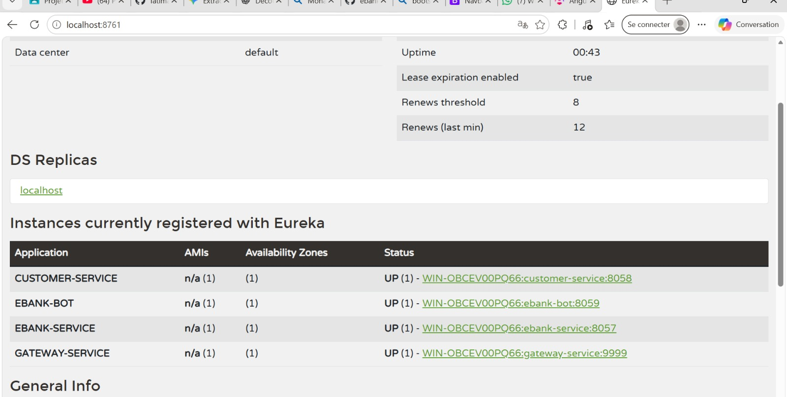

*Figure 2 : Dashboard Eureka — `CUSTOMER-SERVICE` (8058), `EBANK-SERVICE` (8057), `EBANK-BOT` (8059) et `GATEWAY-SERVICE` (9999) sont tous à l'état **UP**.*

### 2.2. Services Métier

#### 2.2.1. `customer-service`

Microservice de gestion des clients (id, nom, email), basé sur Spring Data JPA et exposé via une API REST documentée avec Swagger.

| Méthode | Endpoint | Description |
|---|---|---|
| GET | `/customers` | Liste des clients |
| POST | `/customers` | Création d'un client |
| GET | `/customers/{id}` | Consultation d'un client |

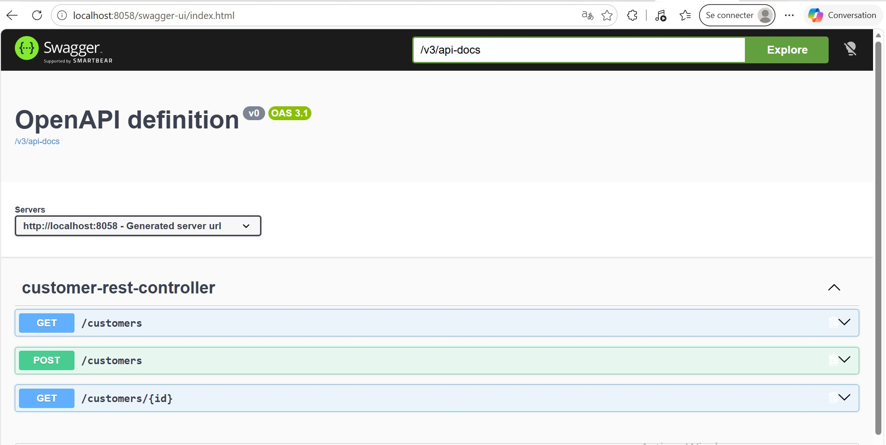

*Figure 3 : Documentation Swagger-UI de `customer-service` (port 8058).*

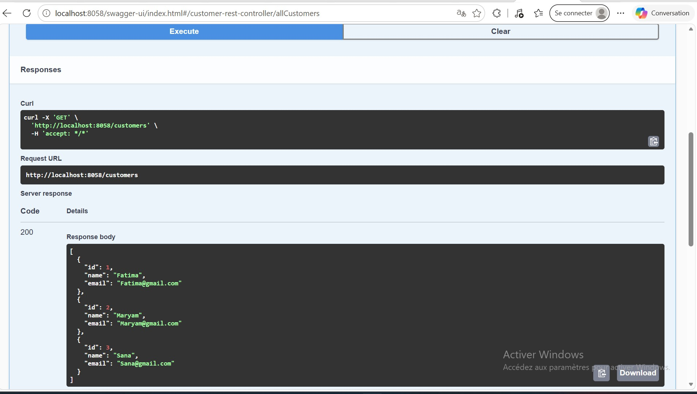

*Figure 4 : Exécution de `GET /customers` — réponse 200 avec les clients Fatima, Maryam et Sana.*

#### 2.2.2. `ebank-service`

Microservice de gestion des comptes bancaires. Deux types de comptes sont gérés : `CURRENT-ACCOUNT` (compte courant) et `SAVING-ACCOUNT` (compte épargne). Chaque compte possède un identifiant (UUID), une date de création, un solde et référence un client par `customerId`.

| Méthode | Endpoint | Description |
|---|---|---|
| GET | `/accounts` | Liste des comptes |
| POST | `/accounts` | Création d'un compte |
| GET | `/accounts/{id}` | Consultation d'un compte |

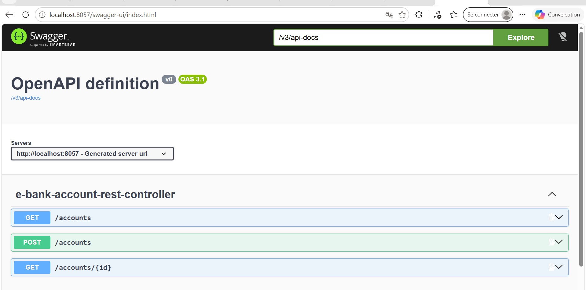

*Figure 5 : Documentation Swagger-UI de `ebank-service` (port 8057).*

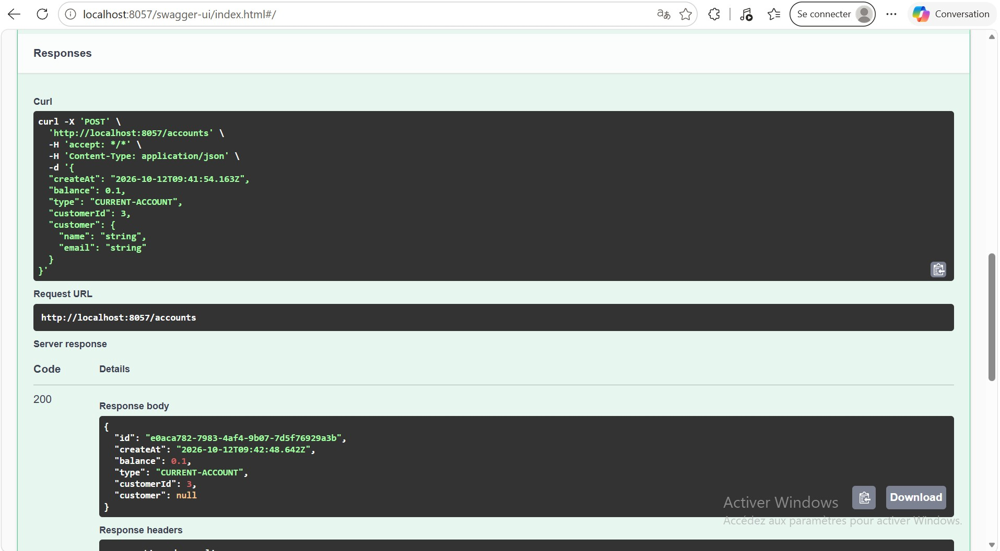

*Figure 6 : Création d'un compte courant via `POST /accounts` — réponse 200 avec l'identifiant généré.*

### 2.3. Communication inter-services avec OpenFeign

`ebank-service` récupère les informations du client propriétaire d'un compte en appelant `customer-service` grâce à **OpenFeign**, un client REST déclaratif qui s'appuie sur Eureka pour localiser le service cible.

- Interface annotée `@FeignClient(name = "CUSTOMER-SERVICE")`
- Activation par `@EnableFeignClients`
- Enrichissement du compte avec l'objet `customer` (nom, email)

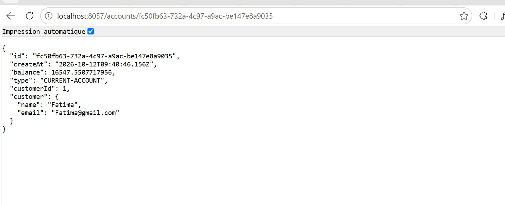

*Figure 7 : `GET /accounts/{id}` — le compte est retourné avec les données du client (Fatima, Fatima@gmail.com) obtenues via Feign.*

### 2.4. Tolérance aux pannes avec Resilience4J (Circuit Breaker)

Sans protection, l'arrêt de `customer-service` ferait échouer les appels de `ebank-service` en cascade. Le **Circuit Breaker** de Resilience4J coupe les appels vers un service défaillant et déclenche une méthode de repli (**fallback**).

- Annotation `@CircuitBreaker` sur l'appel Feign
- Méthode de fallback retournant un client par défaut
- États du circuit : fermé → ouvert → semi-ouvert

**Scénario de test** : arrêt de `customer-service`, puis appel de `GET /accounts/{id}`.

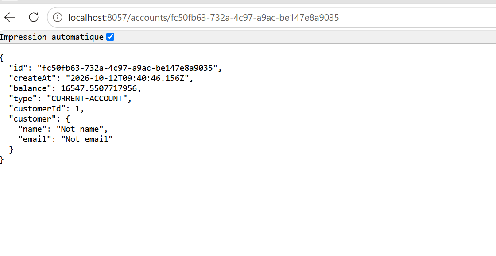

*Figure 8 : Service client arrêté — le compte est tout de même retourné, avec les valeurs de repli `"Not name"` / `"Not email"`.*

### 2.5. Gateway Service (Spring Cloud Gateway)

La gateway est le point d'entrée unique. Elle utilise **Eureka** pour router dynamiquement les requêtes vers les microservices : l'URL `http://localhost:9999/EBANK-SERVICE/accounts` est redirigée vers `ebank-service`.

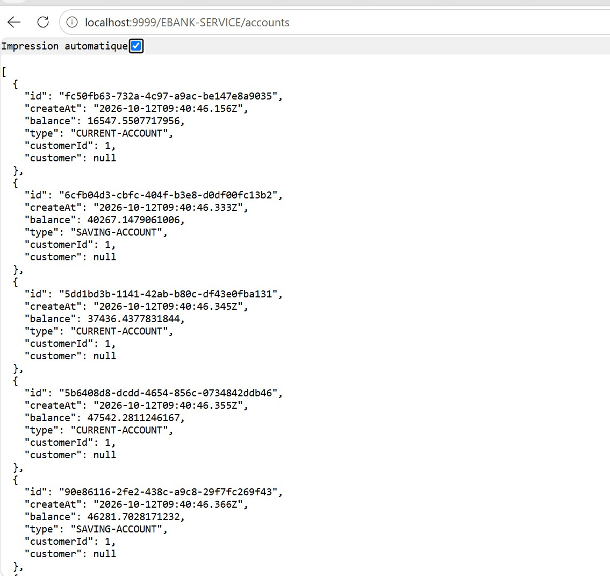

*Figure 9 : Appel de `/EBANK-SERVICE/accounts` à travers la gateway (port 9999).*

### 2.6. Tests des Services Backend (Postman & Swagger-UI)

Les endpoints REST ont été validés avec **Swagger-UI** (figures 3 à 6) et avec un client REST comme **Postman** (requêtes GET et POST sur les clients et les comptes, vérification des codes de réponse et des données).

---

## 3. Partie 2 : Intelligence Artificielle, Agents & Protocoles Avancés (Spring AI & MCP)

### 3.1. Développement de l'Agent AI basé sur Spring AI

Le service `ebank-bot` embarque un **agent IA** construit avec **Spring AI** :

- configuration du client LLM (fournisseur, modèle, clé API) ;
- construction du `ChatClient` avec un **prompt système** qui cadre le comportement de l'agent ;
- exposition d'un endpoint REST `GET /chat?query=...`.

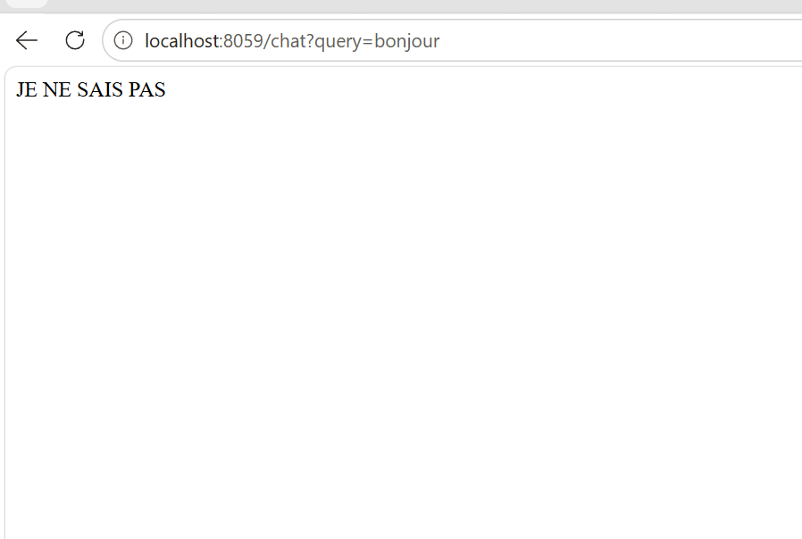

*Figure 10 : Question hors périmètre (`/chat?query=bonjour`) — l'agent, cadré par son prompt système, répond « JE NE SAIS PAS ».*

### 3.2. Exposition des micro-services via MCP

Les fonctionnalités de `customer-service` et `ebank-service` sont exposées comme **outils (tools)** via le protocole **MCP (Model Context Protocol)** en transport **Streamable HTTP**. L'agent découvre ces outils et choisit lui-même lesquels appeler selon la question posée (liste des clients, liste des comptes, détail d'un compte…).

### 3.3. Test via MCP Client & Client REST

Le chatbot est connecté aux microservices par MCP et testé avec un client REST (navigateur / Postman) :

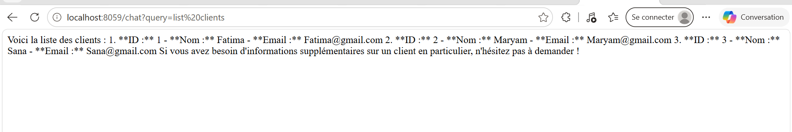

*Figure 11 : `GET /chat?query=list clients` — l'agent appelle l'outil MCP et retourne la liste des clients (Fatima, Maryam, Sana).*

### 3.4. Connexion et Test du Chatbot sur Telegram

Le bot Telegram (**EbankBot**) est créé avec BotFather et intégré dans `ebank-bot` via l'API Telegram. Les messages de l'utilisateur sont transmis à l'agent, qui interroge les microservices et renvoie la réponse en langage naturel.

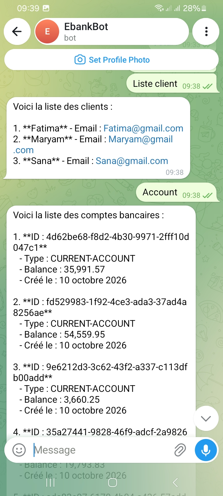

*Figure 12 : Conversation avec EbankBot — messages « Liste client » puis « Account » : le bot retourne la liste des clients puis la liste des comptes bancaires (ID, type, solde, date de création).*

---

## 4. Interface Web Frontend (Angular)

L'application **Angular** (port 4200) consomme les APIs à travers la gateway et propose :

- la liste des comptes bancaires (identifiant, solde, type, date, client) ;
- une page **Bot** pour dialoguer avec l'agent depuis le navigateur.

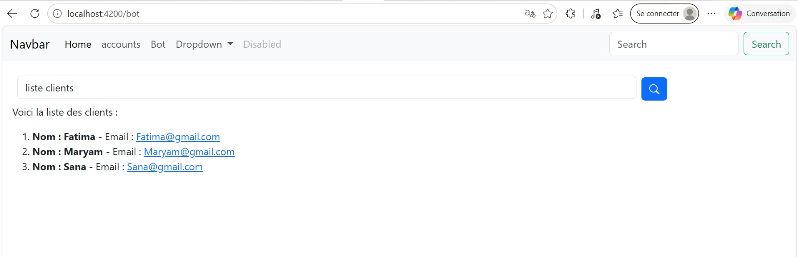

*Figure 13 : Page Bot — la requête « liste clients » retourne la liste des clients.*

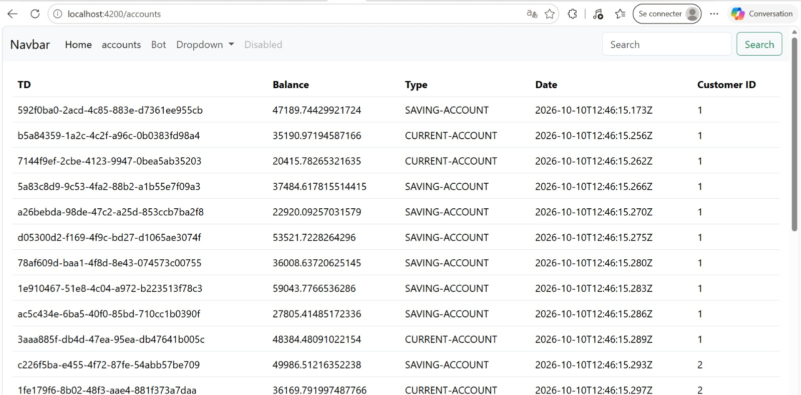

*Figure 14 : Page Accounts — tableau des comptes `SAVING-ACCOUNT` et `CURRENT-ACCOUNT`.*

---

## 5. Conclusion

Ce projet a permis de mettre en pratique :

- la **conception d'une architecture microservices** (Eureka, Gateway, OpenFeign) ;
- la **résilience** avec Resilience4J (Circuit Breaker et fallback) ;
- la **documentation et le test d'APIs** avec Swagger-UI et Postman ;
- l'**intégration de l'IA générative** avec Spring AI ;
- l'exposition de services aux agents via le protocole **MCP** ;
- l'utilisation de **Telegram** et d'**Angular** comme interfaces utilisateur.

**Perspectives** : sécurité (OAuth2 / Keycloak), conteneurisation (Docker / Kubernetes), configuration centralisée (Spring Cloud Config), monitoring.

---

## Installation et exécution

Ordre de démarrage recommandé :

1. `discovery-service` (8761)
2. `customer-service` (8058)
3. `ebank-service` (8057)
4. `gateway-service` (9999)
5. `ebank-bot` (8059) — renseigner la clé API du LLM et le token Telegram
6. `angular-front` : `npm install` puis `ng serve` (4200)

## Références

- Partie 1 : https://www.youtube.com/watch?v=cdFz3VemT1Q
- Partie 2 : https://www.youtube.com/watch?v=JHvxSZTWSsY
