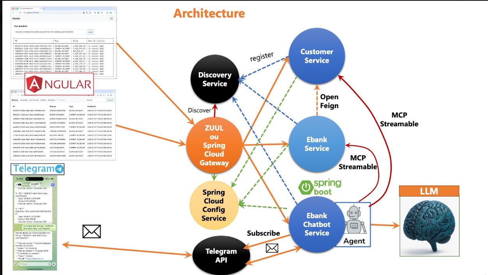

# `ebank-ms-app` - Projet de Synthèse : Systèmes Distribués & Agentic AI

Ce projet représente l'application de synthèse des systèmes distribués encadrée par M. Mohamed Youssfi. Il combine une architecture microservices robuste basée sur **Spring Cloud**, une interface moderne **Angular**, et un assistant intelligent (Chatbot Agentic AI) connectant les services bancaires à **Telegram** via les protocoles **MCP (Model Context Protocol)** et **Spring AI**.

##  Architecture du Projet

Le système repose sur une architecture orientée microservices communicants, orchestrée par une passerelle et un service de découverte :

### Description des composants :
* **`discovery-service` (Eureka)** : Assure l'enregistrement et la découverte dynamique des différents microservices.
* **`gateway-service` (Spring Cloud Gateway)** : Point d'entrée unique gérant le routage des requêtes vers les services backend.
* **`customer-service`** : Microservice de gestion des clients.
* **`ebank-service`** : Microservice métier gérant les comptes bancaires (courants et épargne), exposé également via Swagger.
* **`ebank-bot` (Chatbot Agentic AI)** : Service intelligent intégrant **Spring AI** et un Agent connecté à un LLM, exploitant les données bancaires via le protocole **MCP Streamable** et s'interfaçant avec l'API Telegram.
* **`angular-front`** : Application web front-end permettant la visualisation des clients, des comptes et l'interaction avec le chatbot.

##  Fonctionnalités Clés
1. **Microservices Spring Cloud** : Enregistrement centralisé, routage et configuration distribuée.
2. **Interface Web Angular** : Tableaux de bord dynamiques pour consulter la liste des clients et des comptes bancaires en temps réel.
3. **Agentic AI & MCP** : Intégration d'un assistant conversationnel capable d'interroger dynamiquement les microservices bancaires.
4. **Bot Telegram** : Canal de messagerie instantanée permettant aux utilisateurs d'interagir avec la banque et de récupérer des informations sur les comptes directement depuis Telegram.

##  Technologies Utilisées
* **Backend** : Java (JDK 21), Spring Boot, Spring Cloud (Eureka, Gateway), Spring AI, Spring Data JPA, H2 / MySQL.
* **Frontend** : Angular, TypeScript, Bootstrap.
* **Intelligence Artificielle & Protocoles** : LLM, MCP (Model Context Protocol), Spring AI Agents.
* **Intégration & Outils** : Telegram Bot API, Maven, Swagger / OpenAPI, IntelliJ IDEA.

##  Captures d'écran du projet

### 2. Service de Découverte (Eureka Dashboard)

### 3. Interface Web Angular

### 4. Bot Telegram & Agentic AI

